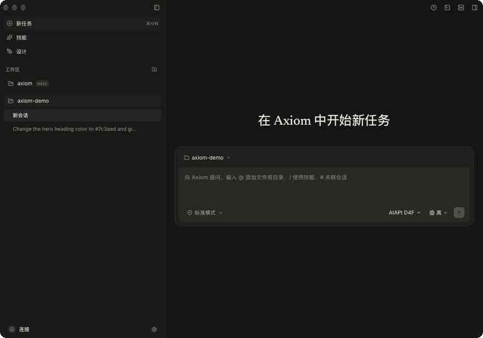

<h1 align="center">Axiom</h1>

<p align="center">
  <strong>A local-first desktop engineering agent for macOS, Linux, and Windows</strong><br />
  <sub>First-party model loop · per-action approval · OS-level sandbox · keys never leave the machine</sub>
</p>

<p align="center">
  <a href="https://github.com/amuluze/axiom-agent/releases/latest"></a>
  <a href="https://github.com/amuluze/axiom-agent/stargazers"></a>
  
  
  
  
</p>

<p align="center">
  <strong>English</strong> · <a href="README.zh-CN.md">简体中文</a>
</p>

<p align="center">
  <a href="https://axiom.amuluze.com"></a>
</p>

<p align="center">
  <a href="https://axiom.amuluze.com">Download</a> ·
  <a href="https://axiom.amuluze.com/#/docs">Docs</a> ·
  <a href="CHANGELOG.md">Changelog</a> ·
  <a href="https://github.com/amuluze/axiom-agent/releases">Releases</a> ·
  <a href="https://github.com/amuluze/axiom-agent/issues">Issues</a>
</p>

---

## What Axiom is

Axiom is a desktop coding agent whose model loop, tool protocol, session state machine, and persistence layer are all first-party — Tauri 2, React 19, Rust, SQLite. There is no Axiom cloud: sessions, branch history, audit chains, artifacts, and model credentials stay in `~/.axiom/` on your machine.

The model reads real files, writes real code, and runs real commands, but only inside a workspace you picked with the native directory picker, and — in standard mode — only after you approved the exact change. Design (`.ax` documents with a live canvas), spec-driven implementation, and UI/API test automation all share that boundary, so artifacts never have to be handed between unrelated tools. The browser, SSH, and terminal panels sit beside it as user-operated surfaces.

### Why it is built this way

| | |
|---|---|
| **Approval is runtime-enforced** | Every write and command needs a one-shot approval lease bound to the session, run, tool call, the canonical command string, and the current workspace grant. Cross-actor, replayed, or post-revocation leases are rejected. |
| **Commands run inside the OS** | macOS seatbelt or Linux bubblewrap — workspace-scoped writes, loopback-only network unless the command declares outbound, sensitive paths denied, output credentials redacted. If the sandbox is unavailable, the command is refused rather than run unsandboxed. |
| **Keys never reach the webview** | Provider endpoints, auth format, and secrets are resolved in Rust. The UI only holds secret IDs; plaintext is injected at request time and never crosses into the webview. |
| **State is local and inspectable** | Branch tree, retry-as-new-branch, checkpoints, per-message provenance. Restart recovery re-verifies integrity and fails closed instead of guessing. |
| **One boundary, not a pipeline of tools** | Workspace grant → approval → sandboxed execution → recoverable transaction covers file edits, batch patches, commands, and restores. |

## Download

| Platform | Installer | Notes |
|---|---|---|
| macOS 12+ · Apple Silicon | `Axiom_*_aarch64.dmg` | Developer ID signed, notarized, self-updating; full feature set |
| macOS 12+ · Intel | `Axiom_*_x86_64.dmg` | Developer ID signed, notarized, self-updating; full feature set |
| Linux x86_64 | `.AppImage` / `.deb` | glibc ≥ 2.36 (Debian 12, Ubuntu 22.04+); AppImage self-updates; command sandbox needs bubblewrap with unprivileged user namespaces |
| Windows 10 / 11 x64 | `Axiom_*_x64-setup.exe` | Preview: no OS sandbox yet, so agent command execution is disabled; not Authenticode-signed (SmartScreen → More info → Run anyway) |

Platform gaps are deliberate and fail closed: where an OS has no equivalent of the sandbox or of the native input-gesture gate that guards the interactive terminals, that channel is disabled instead of being silently relaxed — so the built-in terminal and SSH terminals are macOS-only, and Windows currently ships without agent command execution.

Installers and updates are served from **[axiom.amuluze.com](https://axiom.amuluze.com)** only. GitHub Releases is the build archive: every tagged release also carries `SHA256SUMS.txt`, CycloneDX/SPDX SBOMs, `latest.json`, signed updater bundles, and `release-provenance.json` (upstream commit → public commit → asset hashes).

To verify a downloaded asset:

```bash
gh release download --repo amuluze/axiom-agent --pattern SHA256SUMS.txt
sha256sum -c SHA256SUMS.txt --ignore-missing
```

## Highlights

| Area | What you get |
|---|---|
| First-party runtime | Streaming model loop, rich message protocol, context compaction, restart recovery |
| Tools | read / ls / grep / find / write / edit / batch patch / bash / recoverable delete; deferred tool discovery; results over 256 KiB offloaded to content-addressed storage |
| Security boundary | Explicit workspace authorization, per-action diff approval, seatbelt/bubblewrap sandbox by default, credential redaction, secrets confined to Rust |
| Sessions | Branch tree, retry-as-new-branch, checkpoints, SQLite audit chain, artifact GC |
| Design as code | First-party `.ax` format with a live canvas projection; `.ax` → TSX skeletons, structure reconciliation, pixel-level visual diffing |
| Verification | `tests/*.testspec.json` UI/API automation (stable locators, secrets, approval, redacted evidence) plus read-only review SubAgents |
| Hands-on panels | Isolated browser rail, SSH rail, and a built-in terminal — user-operated. The model reaches the isolated browser only through discover-gated `ui_*` tools (reads free, writes approved) and has no SSH or terminal channel. Interactive terminals are macOS-only |
| Models | Any OpenAI- or Anthropic-compatible endpoint, plus built-in presets for OpenAI, Google Gemini, DeepSeek, Kimi, MiniMax, GLM, Ollama, and relay services — bring your own key |
| Interface | Simplified Chinese and English |

## About this repository

This repository is a filtered, buildable snapshot of Axiom's private upstream, re-exported at every release as a single squash commit, so the full public diff between releases stays reviewable without exposing unrelated history.

- `SOURCE_SNAPSHOT.json` — the exact upstream commit and version behind this snapshot.
- `release-provenance.json` (per tag) — upstream commit → public commit, updater key ID, changelog hash, security fixes, and asset hashes.
- `DISTRIBUTION.md` — how distribution, tags, and provenance relate.

**Issues only — pull requests are not accepted.** Changes land upstream and arrive here through the export, so PRs cannot be merged back and will be closed without review. Bug reports and feature requests as issues are very welcome.

## Build from source

Requirements: macOS 12+ / Linux (x86_64) / Windows 10+ for the shell, Node.js 22+, npm 10+, and Rust 1.96 via [rustup](https://rustup.rs) (pinned by `rust-toolchain.toml`).

```bash
git clone https://github.com/amuluze/axiom-agent.git
cd axiom-agent && npm install

npm run tauri -- dev   # desktop dev mode (native database, files, secrets)
npm run dev            # browser demo mode, deterministic transport, no API key
```

`npm run check` is the full pre-commit gate: typecheck, unit tests, capability/bash-policy/docs-path audits, Rust tests, clippy, and the production build.

## Security

Axiom's guarantees come from runtime mechanisms, not from prompt instructions: workspace grants live in Rust and are restored only from a Rust-owned registry; approvals are one-shot leases; commands execute inside an OS sandbox; model credentials never leave Rust. "Full access" mode exists, but it is an explicit per-session opt-in behind a native warning, and it falls back to standard mode on stop, archive, workspace switch, or restart.

Please report vulnerabilities privately through the Security tab — see [SECURITY.md](SECURITY.md). Do not open a public issue for a security bypass.

## License

[MIT](LICENSE) © 2026 amuluze. The website is the only public channel for installers and updates; this repository is the source snapshot and artifact archive.
