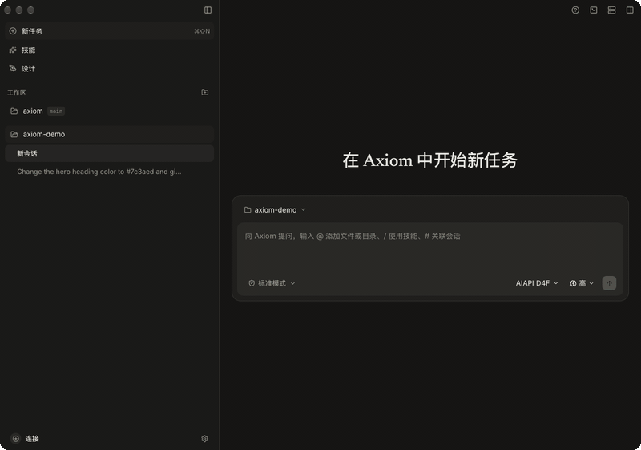

<h1 align="center">Axiom</h1>

<p align="center">
  <strong>本地优先的桌面端工程 Agent，支持 macOS / Linux / Windows</strong><br />
  <sub>自研模型循环 · 逐次审批 · OS 级沙箱 · 密钥不出本机</sub>
</p>

<p align="center">
  <a href="https://github.com/amuluze/axiom-agent/releases/latest"></a>
  <a href="https://github.com/amuluze/axiom-agent/stargazers"></a>
  
  
  
  
</p>

<p align="center">
  <a href="README.md">English</a> · <strong>简体中文</strong>
</p>

<p align="center">
  <a href="https://axiom.amuluze.com"></a>
</p>

<p align="center">
  <a href="https://axiom.amuluze.com">下载</a> ·
  <a href="https://axiom.amuluze.com/#/docs">文档</a> ·
  <a href="CHANGELOG.md">更新日志</a> ·
  <a href="https://github.com/amuluze/axiom-agent/releases">Releases</a> ·
  <a href="https://github.com/amuluze/axiom-agent/issues">问题反馈</a>
</p>

---

## Axiom 是什么

Axiom 是一款桌面端编程 Agent，模型循环、工具协议、会话状态机与持久化边界全部自研——Tauri 2、React 19、Rust、SQLite。没有 Axiom 云端：会话、分支历史、审计链、Artifact 与模型凭据都留在本机的 `~/.axiom/` 下。

模型会读真实文件、写真实代码、跑真实命令，但只在你用原生目录选择器授权的工作区内，标准模式下且只在你确认了确切改动之后。设计（`.ax` 设计稿及其实时画布）、规范驱动的实现与 UI/API 测试自动化共用这一套边界，产物无需在不相干的工具之间搬运；浏览器、SSH 与终端面板则作为用户亲手操作的通道并列其旁。

### 为什么这样设计

| | |
|---|---|
| **审批是运行时强制** | 每次写入与命令都需要一次性审批租约，绑定会话、run、工具调用、规范化命令串与当前工作区授权代际。跨 actor、重复消费或撤销后的租约一律拒绝。 |
| **命令在 OS 沙箱里执行** | macOS seatbelt / Linux bubblewrap：写入限定工作区，默认只开放回环网络（需要出站须显式声明），敏感路径拒绝读取，输出中的凭据被遮盖。沙箱不可用时拒绝执行，而不是退回宿主直跑。 |
| **密钥不进 WebView** | Provider 端点、认证格式与密钥全部由 Rust 解析。UI 只持有 Secret ID，明文在请求期注入，不跨越到 WebView。 |
| **状态本地且可审计** | 分支树、重试即新分支、Checkpoint、逐消息来源。重启恢复重新校验完整性，失败即拒绝恢复，不猜。 |
| **一条边界，而不是一串工具** | 工作区授权 → 审批 → 沙箱内执行 → 可恢复事务，同一条链覆盖文件编辑、批量 Patch、命令执行与恢复。 |

## 下载

| 平台 | 安装包 | 说明 |
|---|---|---|
| macOS 12+ · Apple Silicon | `Axiom_*_aarch64.dmg` | Developer ID 签名、已公证、支持自更新；功能完整 |
| macOS 12+ · Intel | `Axiom_*_x86_64.dmg` | Developer ID 签名、已公证、支持自更新；功能完整 |
| Linux x86_64 | `.AppImage` / `.deb` | 需 glibc ≥ 2.36（Debian 12、Ubuntu 22.04+）；AppImage 支持自更新；命令沙箱需 bubblewrap 与可用的非特权 user namespace |
| Windows 10 / 11 x64 | `Axiom_*_x64-setup.exe` | 预览态：暂无 OS 沙箱，因此不提供命令执行；未做 Authenticode 签名（SmartScreen 选「更多信息 → 仍要运行」） |

平台差异是有意的 fail-closed 结果：某个平台没有沙箱或「原生输入手势门」的等价物时，对应通道直接禁用，而不是悄悄放宽——所以内置终端与 SSH 交互终端仅 macOS 可用，Windows 目前不提供 Agent 命令执行。

安装包与更新只从 **[axiom.amuluze.com](https://axiom.amuluze.com)** 分发。GitHub Releases 是构建产物归档：每个 tag 同时带 `SHA256SUMS.txt`、CycloneDX/SPDX SBOM、`latest.json`、签名的更新包，以及 `release-provenance.json`（上游提交 → 公开提交 → 资产哈希）。

校验下载的包：

```bash
gh release download --repo amuluze/axiom-agent --pattern SHA256SUMS.txt
sha256sum -c SHA256SUMS.txt --ignore-missing
```

## 功能亮点

| 维度 | 你得到 |
|---|---|
| 自研运行时 | 流式模型循环、富消息协议、上下文压缩、重启恢复 |
| 工具 | read / ls / grep / find / write / edit / 批量 Patch / bash / 可恢复删除；工具按需发现；超过 256 KiB 的结果外置到内容寻址存储 |
| 安全边界 | 显式工作区授权、逐次 diff 审批、默认开启 seatbelt/bubblewrap 沙箱、凭据输出遮盖、密钥留在 Rust |
| 会话 | 分支树、重试即新分支、Checkpoint、SQLite 审计链、Artifact 回收 |
| 设计即代码 | 自研 `.ax` 格式与实时画布投影；`.ax` → TSX 骨架、结构对账、像素级视觉对拍 |
| 验证 | `tests/*.testspec.json` UI/API 自动化（稳定 Locator、Secret 引用、逐次审批、脱敏证据）+ 只读审查 SubAgent |
| 用户面板 | 隔离浏览器、SSH 面板、内置终端——都由用户亲手操作。模型只能经 discover-gated 的 `ui_*` 工具触达隔离浏览器（读免审批、写逐次审批），没有 SSH 与终端通道；交互终端仅 macOS 可用 |
| 模型 | 任意 OpenAI / Anthropic 兼容端点，另有 OpenAI、Google Gemini、DeepSeek、Kimi、MiniMax、GLM、Ollama 与中转服务的内置预设——自带 Key |
| 界面语言 | 简体中文、English |

## 关于本仓库

本仓库是 Axiom 私有上游的过滤快照，可完整构建；每次发版导出一个 squash 提交，因此两次发布之间的公开 diff 可完整审阅，又不暴露无关的内部历史。

- `SOURCE_SNAPSHOT.json` —— 本快照对应的上游提交与版本。
- `release-provenance.json`（随 tag 提供）—— 上游提交 → 公开提交、更新签名公钥 ID、CHANGELOG 哈希、安全修复清单与全部资产哈希。
- `DISTRIBUTION.md` —— 分发方式、tag 与来源证明的关系。

**只接受 Issue，不接受 Pull Request。** 改动在上游仓库落地后经导出到达这里，PR 无法合回，会被直接关闭不予审查。Bug 报告与功能请求非常欢迎以 Issue 形式提出。

## 从源码构建

环境：macOS 12+ / Linux (x86_64) / Windows 10+，Node.js 22+，npm 10+，以及经 [rustup](https://rustup.rs) 安装的 Rust 1.96（由 `rust-toolchain.toml` 固定）。

```bash
git clone https://github.com/amuluze/axiom-agent.git
cd axiom-agent && npm install

npm run tauri -- dev   # 桌面开发模式（原生数据库、文件、密钥能力）
npm run dev            # 浏览器演示模式（确定性 Transport，无需 API Key）
```

`npm run check` 是提交前完整门禁：typecheck、单元测试、capability/bash-policy/docs-path 审计、Rust 测试与 clippy，以及生产构建。

## 安全

Axiom 的安全保证来自运行时机制，而不是提示词约定：工作区授权由 Rust 持有且只从 Rust 独占注册表恢复；审批是一次性租约；命令在 OS 沙箱内执行；模型凭据不离开 Rust。「完全访问」模式存在，但它需要为当前会话经原生警告显式开启，并在停止、归档、切换工作区或重启时回落标准模式。

发现漏洞请通过仓库 Security 标签页私下报告——见 [SECURITY.md](SECURITY.md)，不要开公开 Issue。

## 许可证

[MIT](LICENSE) © 2026 amuluze。官网是安装包与更新的唯一公开渠道；本仓库是源码快照与产物归档。
